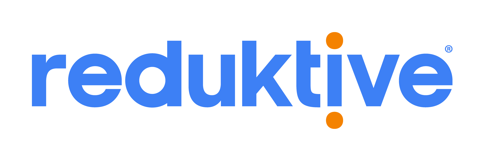

<p align="center">
  <a href="https://www.reduktive.com/opcua/sdk">
    
  </a>
</p>

# Reduktive OPC UA SDK

The Reduktive OPC UA SDK is a modern C++20 SDK for building OPC UA clients and
servers. It is designed around clear APIs, extensibility, performance, and
robust asynchronous operation. OPC UA PubSub support is planned for Q1 CY2027.

[Website](https://www.reduktive.com/opcua/sdk) ·
[Documentation and API reference](https://www.reduktive.com/opcua/sdk/docs) ·
[License](LICENSE) · [Security](SECURITY.md)

> **Current release: `v1.0.0-rc.1`**
>
> This is prerelease software made available for evaluation. APIs and
> capabilities may change, and the SDK is not represented as production-ready
> or certified for industrial use. Reduktive does not issue commercial
> production licences for prerelease versions. Prerelease ends with the stable
> `v1.0.0` release in Q4 CY2026.

> **This repository is a mirror. Development is not undertaken here.**
>
> It is a release-only mirror of Reduktive's private development repository. It
> receives deliberately approved releases rather than ordinary development
> commits, so there are no feature branches, no work in progress, and no history
> between releases. Reduktive does not accept source code, patches, or pull
> requests here; see [CONTRIBUTING.md](CONTRIBUTING.md) for how to report a
> defect or send evaluation feedback.

## What it is

The SDK provides client and server libraries for professional C++ developers
building OPC UA applications, devices, gateways, and industrial systems. The
client and server share common types, encoding, transport, security, address
space, and asynchronous foundations.

The public API is split into separately linkable core, address-space, client,
server, and application libraries. Its asynchronous foundation is Boost.Asio,
used directly rather than hidden behind an SDK-specific executor or scheduler.
Asio dates to 2003, entered Boost in 2005, and has been widely deployed in
networked software for nearly two decades. The SDK also provides synchronous
conveniences for application code where blocking is appropriate. Applications
can supply their own executor or use `ua::Runtime` to own the worker threads and
orderly shutdown.

The same source can run with a single-threaded executor on modest embedded
systems or use a thread pool to take advantage of multicore server hardware.
The lower boundary is an application-class processor with a memory-management
unit (MMU) running a full operating system, such as embedded Linux on an ARM
Cortex-A processor. Linux and Windows are supported. QNX, INTEGRITY, and
VxWorks should also be suitable platforms, but ports have not yet been
completed or validated. Bare-metal systems and Cortex-M-class microcontrollers
are not targets for this SDK.

## Capabilities at a glance

The prerelease includes:

- OPC UA client and server APIs;
- TCP transport, SecureChannel, Session, and service foundations;
- address-space modelling, namespace management, and NodeSet import;
- UA Binary and XML encoding;
- OpenSSL-backed cryptography, X.509 certificates, authentication, and
  authorisation;
- generated OPC UA built-in types, identifiers, status codes, and Namespace 0
  content;
- optional Historical Access support, including a SQLite-backed store; and
- CMake build and installation support.

The exact service, profile, security-policy, platform, and compiler coverage is
version-specific and continues to evolve during the beta. The
[documentation](https://www.reduktive.com/opcua/sdk/docs) is the canonical source
for the current release. The prerelease makes no certification claim.

## Quality

A full configured SDK build registers more than 8,000 unit tests and more than
3,000 integration tests, backed by more than 58,500 source-level `ASSERT_*` and
`EXPECT_*` statements. The suite ships with the source, so those figures can be
reproduced rather than taken on trust — see [Run the test
suite](#run-the-test-suite). The unit suite covers types and codecs, state transitions,
concurrency and lifetime rules, failure paths, and preservation of `StatusCode`
and `ErrorDetail`. End-to-end integration tests exercise service behaviour,
session lifecycles, and complete client/server exchanges over real TCP
connections. Qualification includes GCC, Clang, and MSVC builds in 32-bit and
64-bit configurations; AddressSanitizer, ThreadSanitizer,
UndefinedBehaviorSanitizer, coverage measurement, and independent static-analysis
gates. Coverage-guided fuzzing, soak and load testing, and failure injection
provide additional scrutiny of malformed input and long-running behaviour.

## Getting started

Four routes are supported, and they differ only in where the dependencies come from
and whether the SDK is installed or built inside your project. All four end at the
same place: a program that links `uasdk::uasdk` and prints one line.

| Route | Dependencies from | The SDK is | Best when |
| --- | --- | --- | --- |
| [System packages](#route-1--system-packages) | your distribution | installed, then found with `find_package` | you already manage dependencies with the OS |
| [vcpkg](#route-2--vcpkg) | vcpkg, at the SDK's pinned versions | installed into the vcpkg tree | your project already uses vcpkg |
| [Conan](#route-3--conan) | Conan, at the SDK's pinned versions | a package in the local Conan cache | your project already uses Conan |
| [Vendored source](#route-4--vendor-the-source) | your distribution | built inside your build | you want one compiler and the smallest binary |

### Requirements

The table gives the range each dependency is **verified** against, not the version the
release manifests happen to pin. A pin is a tested point inside the range, not a floor.

| Component | Requirement | Verified against |
| --- | --- | --- |
| CMake | 3.21 or later | 3.28.3 |
| C++ | C++20 | — |
| GCC | 13 or later | 14.3.0, 13.3.0 |
| Clang | 19 or later | 19, 20 (weekly matrix, test suites run) |
| MSVC | 19.50 or later (MSVC Build Tools 14.50, Visual Studio 2026 18.0) | not yet exercised in a release check; 19.44 compiles the libraries in CI |
| Boost | 1.83 or later, **headers plus Boost.JSON** | 1.83.0, 1.88.0 |
| OpenSSL | 1.1.1 (vendor-maintained only; see below) or 3.x | 1.1.1w, 3.0.13, 3.5.9 |
| {fmt} | **9 through 12** | 9.1.0, 10.2.1, 11.0.0, 11.2.0, 12.2.0 |
| SQLite3 | only for the optional SQLite history store | 3.50.4 |

The compiler floors are set by C++20 coroutine code generation, not by a library feature.
The SDK's asynchronous core is coroutine-shaped and relies on symmetric transfer, and each
floor is the first release that contains a specific fix. GCC 13 is the first release that
compiles `co_await` on an expression containing a temporary lambda correctly (GCC bug 101367),
a shape the SDK uses at every asynchronous step. Clang 19 is the first release whose generated
code never touches a coroutine frame after `await_suspend` has handed it to another thread
(LLVM issue 72006, fixed by the `llvm.coro.await.suspend` intrinsics). MSVC 19.50 is the first
toolset that keeps the handle returned by `await_suspend` off the coroutine frame during
symmetric transfer. An older compiler accepts the code and produces wrong behaviour at run
time, which is why these floors cannot be lowered. The SDK's own configure step refuses a
compiler below them with a sentence naming the required version. The floors bind the compiler
that builds the SDK; the coroutine machinery is private, so a project that consumes an installed
SDK with `find_package` needs only a C++20 compiler that is ABI-compatible with the one that
built the archives, which is the ordinary rule for any static library.

Of the Boost libraries the SDK uses — Asio, UUID, Flyweight, Endian, Range and Container
Hash — every one is header-only. Boost.JSON is the single compiled library it links, which
is why the `json` component is the only one requested.

The commands below use Ninja, but the SDK does not require that generator.

### Route 1 — system packages

Nothing but a compiler, CMake and four development packages. On a clean Debian or
Ubuntu system (verified on Ubuntu 24.04, which ships no compiler and no CMake of its own):

```bash
sudo apt-get install -y build-essential cmake ninja-build \
                        libboost-dev libboost-json-dev libssl-dev libfmt-dev
```

Add `libsqlite3-dev` only if you want the bundled SQLite history store, and
`libboost-program-options-dev` only if you want to build the `reference_client` and
`reference_server` examples - no other example needs it, and neither does the SDK. Both are
Debian/Ubuntu concerns specifically, because Debian splits Boost into per-component packages:
on Fedora or RHEL the equivalents are `gcc-c++ cmake ninja-build boost-devel openssl-devel
fmt-devel`, and on macOS with Homebrew `brew install cmake ninja boost openssl fmt`, where
`boost-devel` and `boost` are complete.

Then build and install the SDK, and jump to [using it](#use-the-installed-sdk).

### Build and install the SDK

From the SDK source directory, configure a lean Release build against the dependencies
already on the system:

```bash
cmake -S . -B build-sdk -G Ninja \
  -DCMAKE_BUILD_TYPE=Release \
  -DUASDK_BUILD_TESTS=OFF \
  -DUASDK_BUILD_EXAMPLES=OFF \
  -DUASDK_BUILD_DOCS_EXAMPLES=OFF \
  -DUASDK_REGENERATE_TYPES=OFF \
  -DUASDK_BUILD_HISTORY=OFF \
  -DUASDK_INSTALL=ON
cmake --build build-sdk
cmake --install build-sdk --prefix /absolute/path/to/uasdk-install
```

The generated OPC UA types and Namespace 0 sources are committed, so this build needs no
Python, no type generator, and no network access. It produces static libraries by default;
set `UASDK_BUILD_SHARED=ON` for a shared-library build on Linux.

**What to expect.** Around six minutes at `-j6` on a developer machine, and an install tree
of roughly **340 MB** — five static libraries and 857 headers. Static libraries are large
because every function is emitted into its own section so your linker can discard the ones
you never call; a program that uses a little of the SDK links a little of it.

**Memory.** Allow about 3 GB per parallel compile job for a Release build and about 5 GB for
Debug or RelWithDebInfo; the heaviest translation unit measured peaks at 2.8 GB and 4.7 GB
respectively with GCC 13. On a 16 GB machine, build with `-j4`. Reducing compile time and
memory is the first work item after this release candidate.

**One warning is normal.** A source archive has no Git history, so configuring one prints:

```
CMake Warning: No UASDK_SOURCE_REVISION override or Git revision is available;
               installed capacity documentation will be marked unqualified
```

Nothing is wrong. Pass `-DUASDK_SOURCE_REVISION=<your build id>` to record an identifier
of your own, or ignore it.

Historical Access is a separate, optional tier. To build its SQLite-backed store, install
SQLite3 and configure with `UASDK_BUILD_HISTORY=ON` and `UASDK_BUILD_HISTORY_SQLITE=ON`. To
provide your own history store, use `UASDK_BUILD_HISTORY=ON` with
`UASDK_BUILD_HISTORY_SQLITE=OFF`.

### Route 2 — vcpkg

Use **manifest mode**. The SDK's `vcpkg.json` carries a `builtin-baseline` and version
`overrides` that pin the whole dependency set to versions this release is tested against;
manifest mode honours them and classic mode (`vcpkg install uasdk`) silently ignores both
and resolves whatever is current instead.

Get vcpkg. A shallow clone cannot satisfy a baseline, because the commit a manifest names
is not in it:

```bash
git clone --filter=blob:none https://github.com/microsoft/vcpkg /opt/vcpkg
/opt/vcpkg/bootstrap-vcpkg.sh -disableMetrics
```

vcpkg itself needs `git curl zip unzip tar pkg-config` alongside a compiler and CMake.

Beside your application, write a `vcpkg.json` that depends on `uasdk` and copies the
`builtin-baseline` and `overrides` blocks verbatim from the SDK's own `vcpkg.json`:

```json
{
  "name": "my-opcua-app",
  "version-string": "0.1.0",
  "dependencies": [ "uasdk" ],
  "builtin-baseline": "<copy from the SDK's vcpkg.json>",
  "overrides": [ "<copy from the SDK's vcpkg.json>" ]
}
```

The SDK ships a vcpkg port in `ports/uasdk`. Point vcpkg at it as an overlay and configure
as usual; the port finds the SDK source tree it ships inside, so nothing is downloaded:

```bash
cmake -S . -B build -G Ninja \
  -DCMAKE_BUILD_TYPE=Release \
  -DCMAKE_TOOLCHAIN_FILE=/opt/vcpkg/scripts/buildsystems/vcpkg.cmake \
  -DVCPKG_OVERLAY_PORTS=/path/to/reduktive-opcua-sdk/ports
cmake --build build
```

To build the SDK from a checkout elsewhere, set `UASDK_SOURCE_DIR` to it. The port's
optional features are `history` and `sqlite-store`: request them as `uasdk[sqlite-store]`.

vcpkg builds OpenSSL from source on a cold cache, which dominates the first run; the Boost
packages are per-library and the header-only ones install in about a second each.

### Route 3 — Conan

Conan 2 is required, and two settings are not optional. **The C++ standard must be given
explicitly**: `conan profile detect` writes `compiler.cppstd=gnu17`, and the SDK refuses to
configure below C++20. **The build type must be given too**: the `uasdk-config.cmake` that
`CMakeDeps` generates calls `check_build_type_defined()`, which stops the configure with
`Please, set the CMAKE_BUILD_TYPE variable` if it is missing.

Install Conan into a virtual environment. A recent Debian or Ubuntu refuses a plain
`pip install` into the system interpreter with `externally-managed-environment`:

```bash
sudo apt-get install -y build-essential cmake ninja-build python3 python3-venv git
python3 -m venv ~/.venvs/conan
~/.venvs/conan/bin/pip install 'conan>=2.0'
export PATH="$HOME/.venvs/conan/bin:$PATH"
```

Build the package from the SDK source tree:

```bash
conan profile detect --force
conan create /path/to/reduktive-opcua-sdk --build=missing -s compiler.cppstd=20
```

Then depend on it from your application's `conanfile.txt`:

```ini
[requires]
reduktive-opcua-sdk/1.0.0-rc.1

[generators]
CMakeDeps
CMakeToolchain
```

```bash
conan install . --output-folder=build --build=missing -s compiler.cppstd=20
cmake -S . -B build -G Ninja \
  -DCMAKE_BUILD_TYPE=Release \
  -DCMAKE_TOOLCHAIN_FILE=build/conan_toolchain.cmake
cmake --build build
```

**The first run is long.** Requiring C++20 changes the package identifier, so ConanCenter's
prebuilt binaries no longer match and Boost and OpenSSL are compiled from source. The SDK's
recipe asks Boost for only the three compiled libraries it uses — JSON, Container and
System — out of the thirty-three that package builds by default, which removes most of that
cost but not all of it. Later builds come from the Conan cache.

Conan's channel exposes the same `uasdk::` targets as the others, generated by `CMakeDeps`
from the recipe's component graph.

### Route 4 — vendor the source

Drop the SDK into your own tree and add it directly:

```cmake
add_subdirectory(third_party/reduktive-opcua-sdk)
target_link_libraries(my_opcua_app PRIVATE uasdk::uasdk)
```

`FetchContent` exposes the same targets; pin it to an immutable release tag or commit rather
than a moving branch. As a subproject the SDK's tests, examples, documentation examples, type
generator and history component all default off.

This route produces the smallest binaries: one compiler builds everything, so link-time
optimisation stays on and the linker can discard unreferenced code across the whole program.
How much that saves depends on how much of the SDK your application uses, so measure it.

An installed package is built without link-time optimisation on purpose,
because a `-flto` static library is tied to the exact compiler that produced it and a
licensee who builds their application with a different one gets a link failure that reads
like a corrupt archive. If you control both compilers, configure the SDK with
`-DENABLE_LTO=ON` to get the smaller result from an installed package too.

### Use the installed SDK

A consuming application's `CMakeLists.txt` needs only the installed package and
an exported target:

```cmake
cmake_minimum_required(VERSION 3.21)
project(my_opcua_app LANGUAGES CXX)

find_package(uasdk CONFIG REQUIRED)

add_executable(my_opcua_app main.cpp)
target_link_libraries(my_opcua_app PRIVATE uasdk::uasdk)
```

As a minimal compile-and-link check, create `main.cpp`:

```cpp
#include "ua_node_id.h"
#include "ua_to_string.h"
#include "ua_variable_id.h"

#include <iostream>

int main()
{
  const ua::NodeId serverStatusState{ua::VariableId::Server_ServerStatus_State};
  std::cout << ua::to_string(serverStatusState) << '\n';
}
```

Point CMake at the installation prefix, build, and run it:

```bash
cmake -S . -B build -G Ninja -DCMAKE_PREFIX_PATH=/absolute/path/to/uasdk-install
cmake --build build
./build/my_opcua_app
```

The program prints `i=2259`. It deliberately checks package discovery, the flat
public-header layout, and a real symbol from the core library without requiring
an OPC UA endpoint.

Public headers are always included by bare name, as above:
`#include "ua_server.h"`, not `#include "server/ua_server.h"`. The exported
target supplies the include directories, required C++ language level, libraries,
and transitive dependencies.

### Run the test suite

The SDK's own unit and integration tests ship with the source, so its behaviour
can be checked rather than believed. They are off by default. Enabling them needs
GoogleTest, and the configure step fetches the OPC Foundation's UA-Nodeset
repository, from which the tests read Namespace 0 data files — the lean build
above needs no network access, but this one does.

```bash
cmake -S . -B build-tests -G Ninja \
  -DCMAKE_BUILD_TYPE=Release \
  -DUASDK_BUILD_TESTS=ON
cmake --build build-tests
ctest --test-dir build-tests --output-on-failure
```

The build produces two GoogleTest binaries: `build-tests/tests/tests` holds the
unit suites, and `build-tests/tests/integration_tests` drives a real server over a
real secure channel. Both take the usual GoogleTest options, so one area can be
run on its own:

```bash
./build-tests/tests/tests --gtest_filter='NodeId*'
```

Two integration tests are absent from this tree. They check that the certificate
validator refuses structurally non-conformant certificates, and they need the
private key of a test-vector certificate authority to issue the well-formed
control certificate they compare against; a public release does not carry a
private key. Every other test built on the same fixture is present.

`tests/development_only_tests.txt` lists the tests that are built but cannot pass
from this tree, and with CMake 3.22 or later `ctest` leaves them out. Seven read
the SDK's development checkout, and twelve `Chaos` tests need a
[toxiproxy](https://github.com/Shopify/toxiproxy) service; to run those, start
one listening on port 8474 and run
`./build-tests/tests/integration_tests --gtest_filter='Chaos.*'`.

Each example ships with a behaviour test that runs the program and compares its
whole output to the expected output recorded beside it. These tests need a
Python 3 interpreter, so they are off by default and a build without one still
configures. To run them, configure with `UASDK_BUILD_EXAMPLE_TESTS=ON` and then
run `ctest` in the build directory.

### Link only what you use

`uasdk::uasdk` is the simplest default, and it is not the wasteful one: these are
static libraries, so the linker takes only the objects your program actually refers to
and an unused role library contributes nothing. Naming `uasdk::core` instead of
`uasdk::uasdk` does not make a smaller program — measured, the two produce a byte-identical
binary. Name a narrower target to constrain the *dependency* surface, or to state in your
build what your application is allowed to reach for:

| Target | Contents |
| --- | --- |
| `uasdk::core` | Types, codecs, asynchronous utilities, security, transport, and generated code |
| `uasdk::address-space` | The server information model; depends on core |
| `uasdk::client` | Client APIs; depends on core |
| `uasdk::server` | Secure channels, sessions, services, and subscriptions; depends on core and the address space |
| `uasdk::app` | Helpers that compose client and server roles |
| `uasdk::uasdk` | The complete core, address-space, client, server, and application SDK |

Historical Access is linked separately as `uasdk::history` or
`uasdk::history-sqlite` after requesting the corresponding `history` or
`sqlite-store` component from `find_package`.

## API model in brief

Many SDK operations are offered in three forms:

| Form | Result | Throws? | Intended use |
| --- | --- | --- | --- |
| `*_async` | Delivers `Result<T>` to a callback | Never | Composed asynchronous work; this is the canonical implementation |
| `*_sync` | Returns `T` directly | Throws `UaException` on failure | Top-level application code where blocking is acceptable |
| `try_*_sync` | Returns `Result<T>` | Never | Blocking application code that handles errors explicitly |

The core client and server APIs accept a caller-owned Boost.Asio executor and do
not hide their execution context. `ua::Runtime` is the convenience option: it
owns an executor, runs its workers, shuts down attached SDK handles in reverse
order, and then joins the workers.

Never call a blocking `*_sync` or `try_*_sync` operation from an SDK callback or
executor thread. On a single-threaded executor, it waits for work that only the
blocked thread can perform. Stay on the `*_async` path when composing operations.

Failures returned through `Result<T>` carry an OPC UA `StatusCode`. Where
available, the status code includes an `ErrorDetail` describing the failing step
and its context. Preserve the status code through application error paths so
that its detail remains available when the failure is handled or logged.

## Documentation

The [SDK documentation](https://www.reduktive.com/opcua/sdk/docs) initially
provides the versioned Doxygen-generated C++ API reference and a concise
overview of the SDK.

A three-volume user guide, *Programming OPC UA in Modern C++*, will be
available shortly: on the documentation site, as a free ebook, and in print
from Amazon. The documentation site is the canonical location for API reference
material, guides, books, capabilities, and release-specific information.

After the compile-and-link check above, the *Hello, OPC UA* walkthrough is the
first end-to-end exercise. It starts a development server, opens a client Secure
Channel and Session, reads the built-in ServerStatus State, and closes each
protocol object in order. Its anonymous `None`-security endpoint is deliberately
limited to local evaluation; the security chapters replace it with certificate
validation, authentication, and encrypted message security.

### The examples

Twenty-eight worked programs live under [`examples/`](examples/README.md) — fourteen client,
thirteen server, and one that is both. Each is a complete program with its own README, not a
snippet, and each names the capabilities it demonstrates.

Start with **[`quickstart/roundtrip`](examples/quickstart/roundtrip)**: a secure server and a
client in one process, in one command. It is the fastest proof that your build and your
certificates work.

After that the client and server examples pair up, so you can run two halves of the same
subject against each other:

| Subject | Server | Client |
| --- | --- | --- |
| The smallest working program | `server/minimal` | `client/minimal` |
| Building and browsing a model | `server/address_space`, `server/nodeset_and_methods` | `client/browse_and_call` |
| Watching values change | `server/data_access` | `client/subscriptions`, `client/data_access` |
| Events and alarms | `server/events`, `server/alarms` | `client/events`, `client/alarms` |
| Identity and authorization | `server/authentication` | `client/authentication`, `client/discovery` |
| Types you define yourself | `server/custom_types` | `client/custom_types` |
| Historical Access | `server/history` | `client/history` |
| Files as nodes | `server/file_transfer` | `client/file_transfer` |
| Certificate management | `server/push_certificates` | `client/push_certificates` |
| Connecting the other way round | `server/reverse_connect` | `client/reverse_connect` |
| Surviving a dropped connection | — | `client/reconnect_and_keepalive` |
| Observing what the server does | `server/diagnostics` | — |

Examples build by default when the SDK is the top-level project; a subproject build leaves
them off. To build them explicitly, configure with `-DUASDK_BUILD_EXAMPLES=ON`. Every example
also builds **outside** this repository against an installed SDK — copy its directory together
with `examples/support/` and point CMake at your install prefix, exactly as
[Route 1](#route-1--system-packages) does.

The [examples README](examples/README.md) carries the full table, mapping each program to the
specific capability-matrix rows it exercises.

### Canonical reference applications

For a secure, runnable application pair, start with the
[reference server](examples/reference_server/README.md) and
[reference client](examples/reference_client/README.md). Together they show persistent application
PKI and explicit mutual trust, secure EasyConnect, namespace-safe browsing, typed reads, a validated
write with read-back, a data-change Subscription, successful and failed Method calls, complete
`ErrorDetail` handling, and orderly shutdown.

The pair is deliberately compact. History, Alarms and Events, File Transfer, GDS, and PubSub will be
covered by focused examples rather than obscuring the core client/server usage pattern.

## Status and roadmap

The initial public release is `v1.0.0-rc.1`. Further release candidates will be
published only when needed, followed by the stable `v1.0.0` release in Q4
CY2026.

During the release-candidate phase, work focuses first on reducing compile time and
compiler memory (see [Build and install the SDK](#build-and-install-the-sdk)), then on API
refinement, release qualification, examples, and the expanded documentation described above. OPC UA PubSub support
is planned for Q1 CY2027 as the first major post-`1.0.0` addition. Current
product status and roadmap information are published on the
[SDK website](https://www.reduktive.com/opcua/sdk).

## Source available — not open source

The Reduktive Source Available License permits copying and redistribution of
exact, unmodified Source and Object copies, production of Object forms from the
unmodified Source, use of the unmodified SDK for NonCommercial purposes, and
non-production use. It does not permit modification or Derivative Works.
Commercial production use requires a separate written licence from Reduktive
Limited, and commercial production licences are not issued for prerelease
versions.

This summary is not a licence and does not grant rights. The terms in
[LICENSE](LICENSE) control. Third-party material remains governed by the terms
identified in [THIRD_PARTY_NOTICES.md](THIRD_PARTY_NOTICES.md).

## Repository and releases

This public repository is a release-only source mirror. It receives deliberately
approved releases rather than ordinary private development commits. Every
public commit has one matching annotated version tag, beginning with
`v1.0.0-rc.1`.

## Contributions, feedback, and security

This is not a community-development project. Reduktive does not accept source
code, patches, or pull requests. Factual, code-free bug reports and evaluation
feedback may be submitted through
[GitHub Issues](https://github.com/reduktive/opc-ua-sdk/issues). See
[CONTRIBUTING.md](CONTRIBUTING.md) for the feedback policy.

Do not report suspected vulnerabilities in a public issue. Follow
[SECURITY.md](SECURITY.md) and contact security@reduktive.com. Prerelease
versions do not carry a production-support commitment or service-level
agreement.
